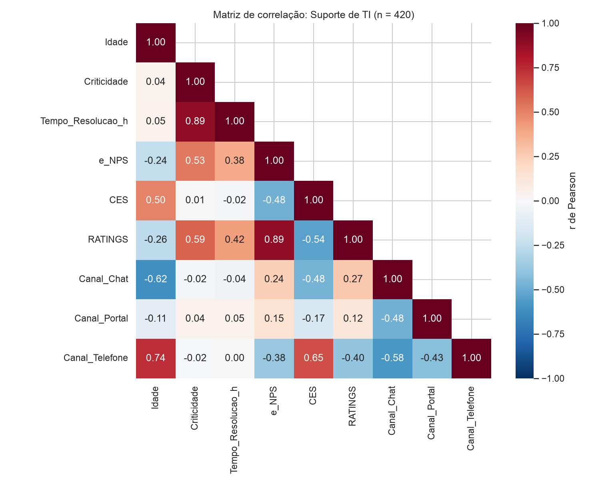

# 01_heatmap

[Índice da biblioteca](../../README.md)

> Fonte: `Aulas/AI-Core-Concepts/04_Hands_On_Correlacao/entrega/graficos/01_heatmap.png`  
> SHA-256: `65f94e0d14c1b9c3e1ea3d98c7c6e568cdaaec65bbe0b3bc6399a91cfc1fdd1e`  
> Imagem original incorporada para consulta visual; o texto da imagem não foi transcrito por OCR.  
> Material do acervo acadêmico fornecido pelo usuário. Autoria e direitos permanecem com os titulares indicados na fonte.

---

