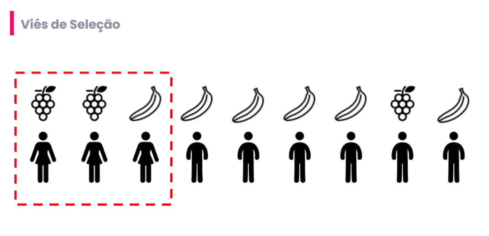

# 01_vies_selecao

[Índice da biblioteca](../../README.md)

> Fonte: `Aulas/AI-Core-Concepts/01_Material_da_Aula/prints_da_aula/01_vies_selecao.png`  
> SHA-256: `6f4e2d29b52d22cdf0ca749233f784e667c67633592e9f5d6c8a85a836fb7451`  
> Imagem original incorporada para consulta visual; o texto da imagem não foi transcrito por OCR.  
> Material do acervo acadêmico fornecido pelo usuário. Autoria e direitos permanecem com os titulares indicados na fonte.

---

