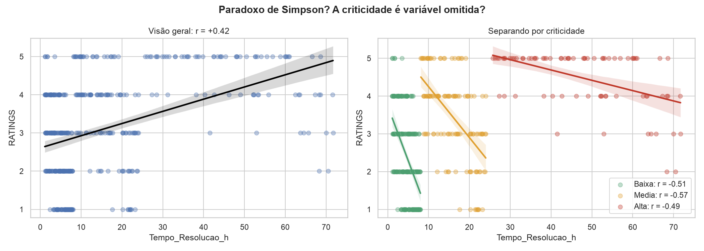

# 02_simpson

[Índice da biblioteca](../../README.md)

> Fonte: `Aulas/AI-Core-Concepts/04_Hands_On_Correlacao/entrega/graficos/02_simpson.png`  
> SHA-256: `4065a8b1c8a5b2dbb427084172e3472ad24d07eab336d681a7e4a488696db50e`  
> Imagem original incorporada para consulta visual; o texto da imagem não foi transcrito por OCR.  
> Material do acervo acadêmico fornecido pelo usuário. Autoria e direitos permanecem com os titulares indicados na fonte.

---

