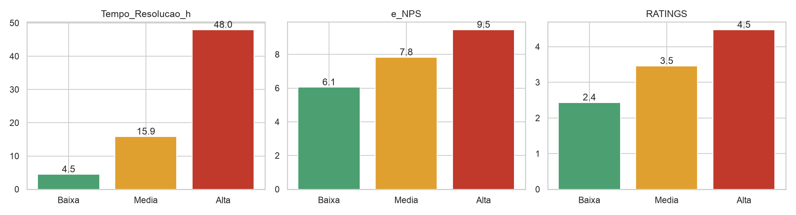

# 03_criticidade

[Índice da biblioteca](../../README.md)

> Fonte: `Aulas/AI-Core-Concepts/04_Hands_On_Correlacao/entrega/graficos/03_criticidade.png`  
> SHA-256: `550f857882f018224c9bf1ed8fb94983ee24b65741f104d82c5058765ade5cea`  
> Imagem original incorporada para consulta visual; o texto da imagem não foi transcrito por OCR.  
> Material do acervo acadêmico fornecido pelo usuário. Autoria e direitos permanecem com os titulares indicados na fonte.

---

