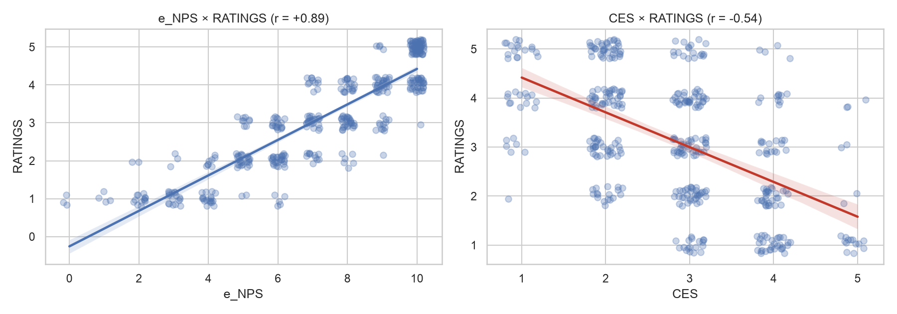

# 05_satisfacao_esforco

[Índice da biblioteca](../../README.md)

> Fonte: `Aulas/AI-Core-Concepts/04_Hands_On_Correlacao/entrega/graficos/05_satisfacao_esforco.png`  
> SHA-256: `984d80e5770c10f5ba5f69d7e09dd31f0e7a831253218ac07fa904e50124b2bd`  
> Imagem original incorporada para consulta visual; o texto da imagem não foi transcrito por OCR.  
> Material do acervo acadêmico fornecido pelo usuário. Autoria e direitos permanecem com os titulares indicados na fonte.

---

