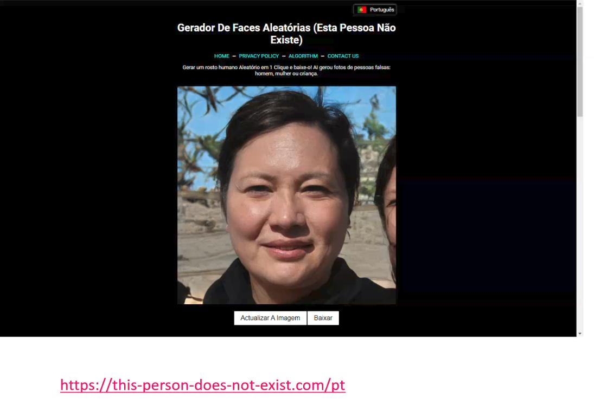

# 08_this_person_does_not_exist

[Índice da biblioteca](../../README.md)

> Fonte: `Aulas/AI-Core-Concepts/01_Material_da_Aula/prints_da_aula/08_this_person_does_not_exist.png`  
> SHA-256: `0cb2fc17150f68b0ba82448264d2467e0f72bfb771a7ffca31d57d9f947ac0cd`  
> Imagem original incorporada para consulta visual; o texto da imagem não foi transcrito por OCR.  
> Material do acervo acadêmico fornecido pelo usuário. Autoria e direitos permanecem com os titulares indicados na fonte.

---

