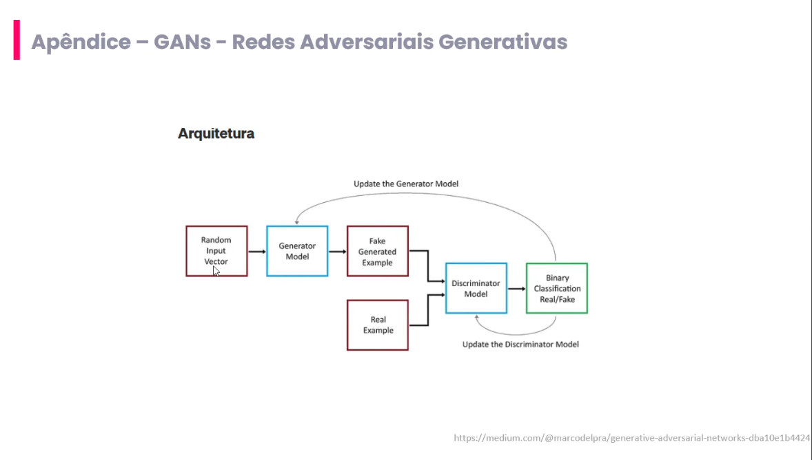

# 09_gans_arquitetura

[Índice da biblioteca](../../README.md)

> Fonte: `Aulas/AI-Core-Concepts/01_Material_da_Aula/prints_da_aula/09_gans_arquitetura.png`  
> SHA-256: `ee166bc61e153704b130e4d0ae83a8f12cc6a3f8fbcca5d34ce6f9da472004bf`  
> Imagem original incorporada para consulta visual; o texto da imagem não foi transcrito por OCR.  
> Material do acervo acadêmico fornecido pelo usuário. Autoria e direitos permanecem com os titulares indicados na fonte.

---

