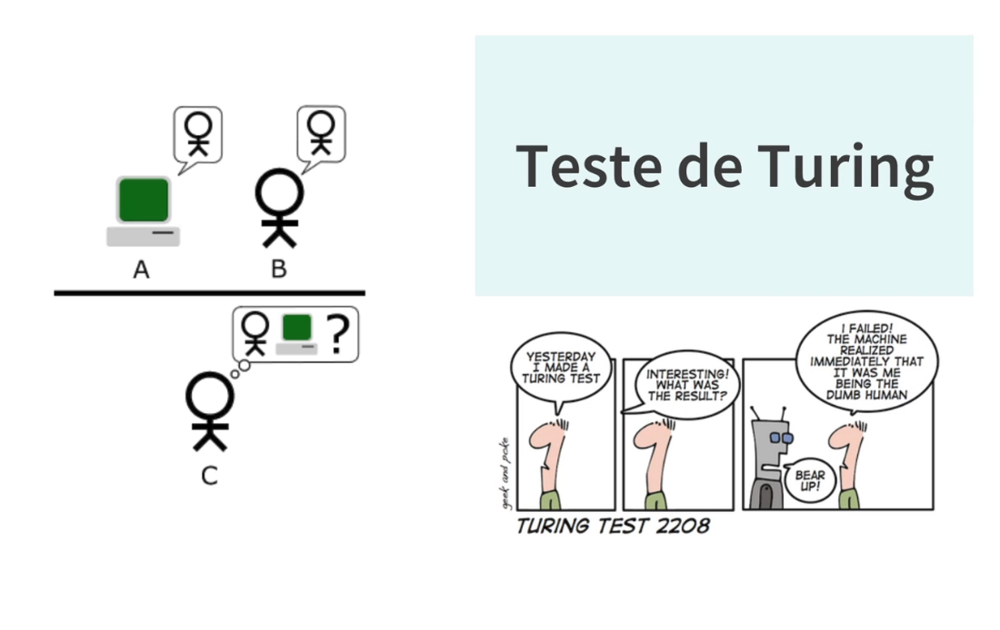

# 11_teste_turing

[Índice da biblioteca](../../README.md)

> Fonte: `Aulas/AI-Core-Concepts/01_Material_da_Aula/prints_da_aula/11_teste_turing.png`  
> SHA-256: `67b9ec9f8f7d6dc52cf47d6838ff0702904d38e1098da3d23d1f888fb8dd8d7d`  
> Imagem original incorporada para consulta visual; o texto da imagem não foi transcrito por OCR.  
> Material do acervo acadêmico fornecido pelo usuário. Autoria e direitos permanecem com os titulares indicados na fonte.

---

