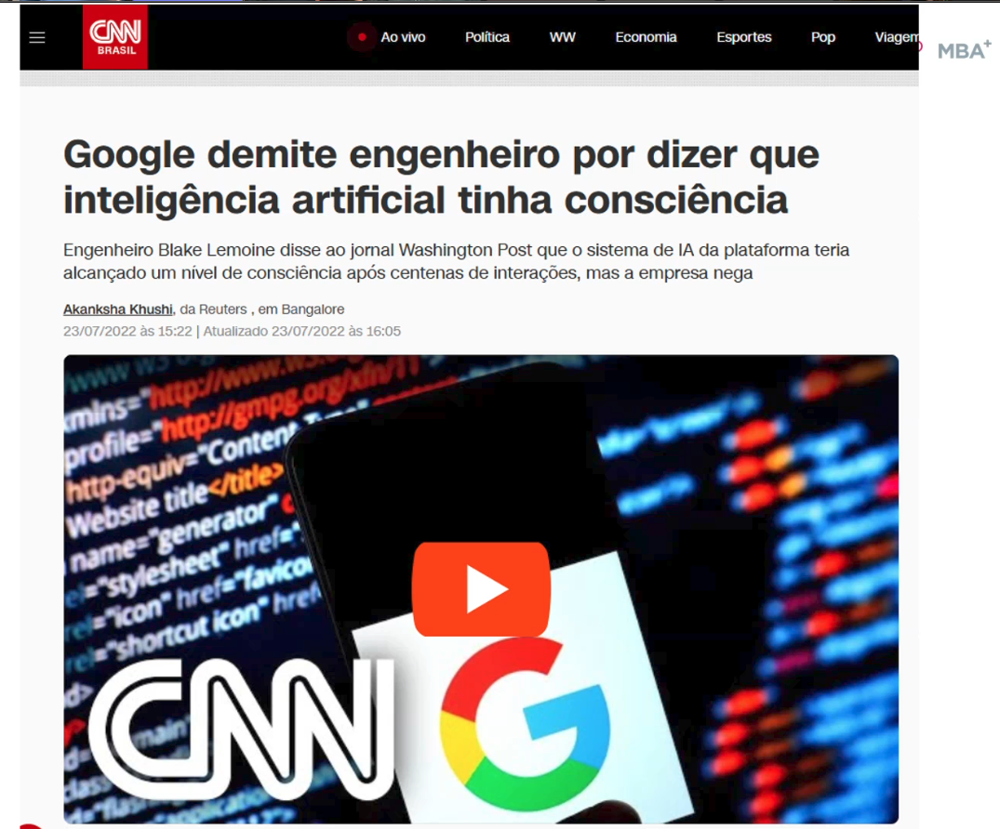

# 12_google_lamda_lemoine

[Índice da biblioteca](../../README.md)

> Fonte: `Aulas/AI-Core-Concepts/01_Material_da_Aula/prints_da_aula/12_google_lamda_lemoine.png`  
> SHA-256: `b03997fb83222adf3f3b2aa27f7425ded3a337e84541b74cafc9955297db676b`  
> Imagem original incorporada para consulta visual; o texto da imagem não foi transcrito por OCR.  
> Material do acervo acadêmico fornecido pelo usuário. Autoria e direitos permanecem com os titulares indicados na fonte.

---

