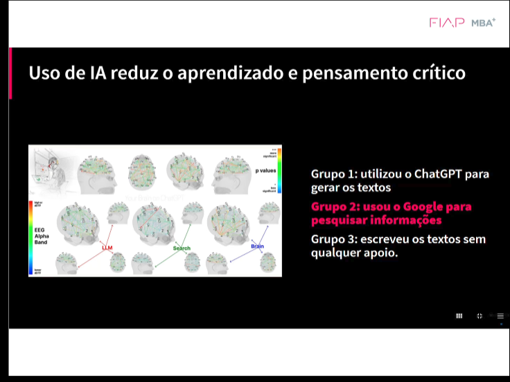

# 13_ia_pensamento_critico_mit

[Índice da biblioteca](../../README.md)

> Fonte: `Aulas/AI-Core-Concepts/01_Material_da_Aula/prints_da_aula/13_ia_pensamento_critico_mit.png`  
> SHA-256: `04551aa2aa4f7a6348709883df9f13ba167ff50292cdbf290894a597bab952d7`  
> Imagem original incorporada para consulta visual; o texto da imagem não foi transcrito por OCR.  
> Material do acervo acadêmico fornecido pelo usuário. Autoria e direitos permanecem com os titulares indicados na fonte.

---

