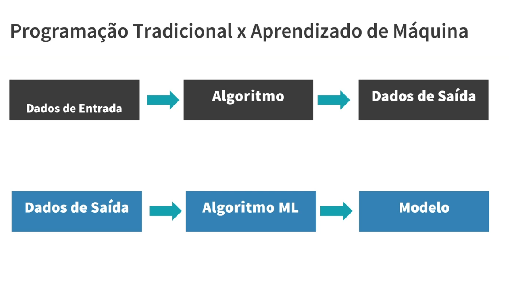

# 16_programacao_vs_ml

[Índice da biblioteca](../../README.md)

> Fonte: `Aulas/AI-Core-Concepts/01_Material_da_Aula/prints_da_aula/16_programacao_vs_ml.png`  
> SHA-256: `18e3825b6190413527a8775fcb9bf8670824d35dfb1251f5ade27a56bda2715c`  
> Imagem original incorporada para consulta visual; o texto da imagem não foi transcrito por OCR.  
> Material do acervo acadêmico fornecido pelo usuário. Autoria e direitos permanecem com os titulares indicados na fonte.

---

