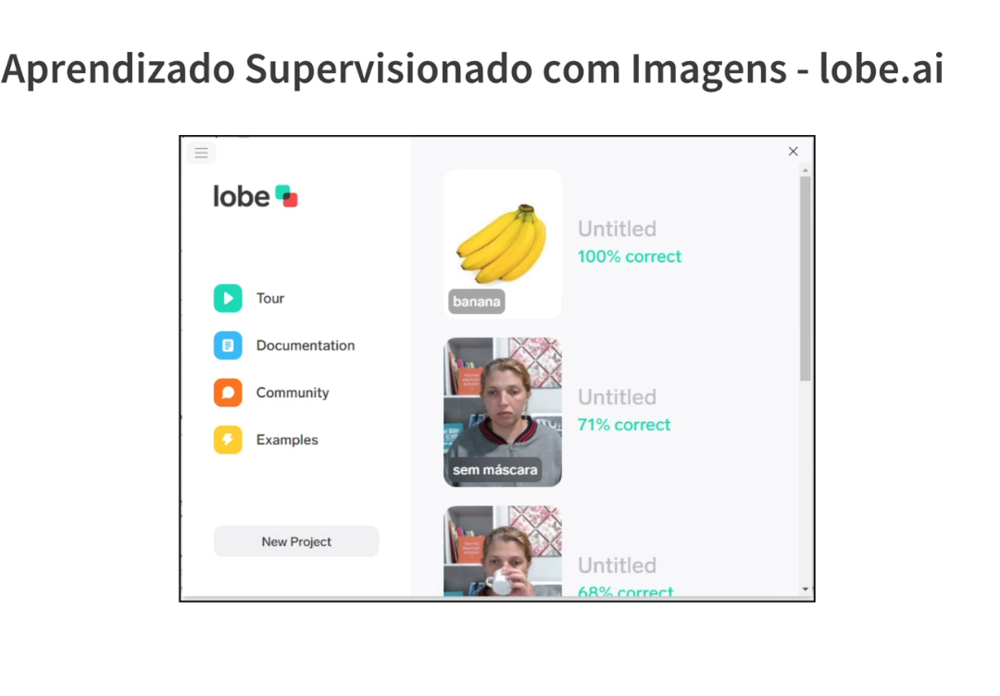

# 17_lobe_ai

[Índice da biblioteca](../../README.md)

> Fonte: `Aulas/AI-Core-Concepts/01_Material_da_Aula/prints_da_aula/17_lobe_ai.png`  
> SHA-256: `3471a4c7fccdc074af140235b55e43c1c782d167086530c1b487cc3155a3b771`  
> Imagem original incorporada para consulta visual; o texto da imagem não foi transcrito por OCR.  
> Material do acervo acadêmico fornecido pelo usuário. Autoria e direitos permanecem com os titulares indicados na fonte.

---

