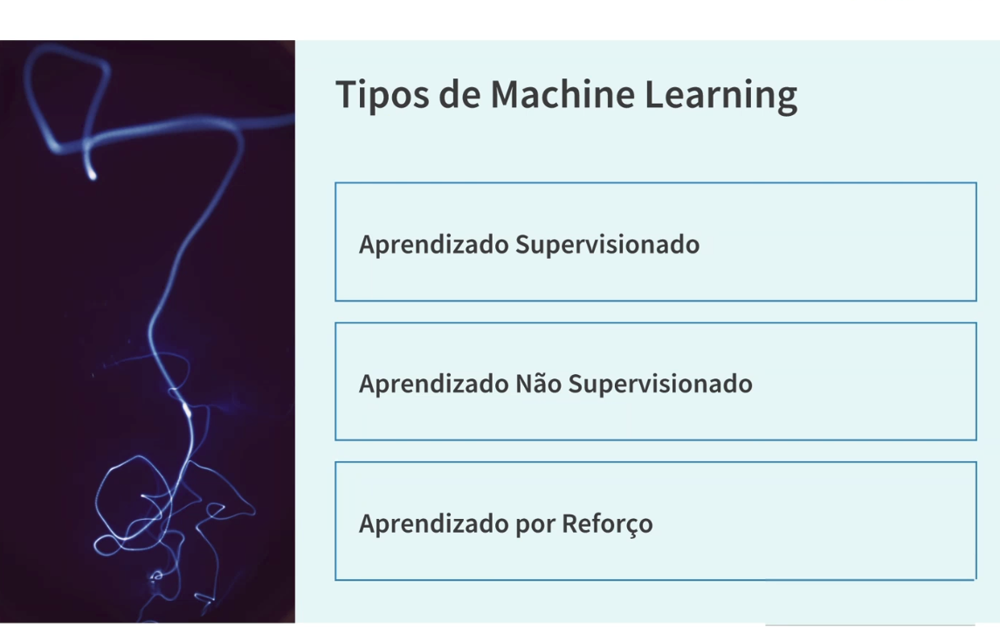

# 18_tipos_ml

[Índice da biblioteca](../../README.md)

> Fonte: `Aulas/AI-Core-Concepts/01_Material_da_Aula/prints_da_aula/18_tipos_ml.png`  
> SHA-256: `21a07c0a57a8a935737dec8357642690ec75bf3a8107317f3e17bbcb828c0b3a`  
> Imagem original incorporada para consulta visual; o texto da imagem não foi transcrito por OCR.  
> Material do acervo acadêmico fornecido pelo usuário. Autoria e direitos permanecem com os titulares indicados na fonte.

---

