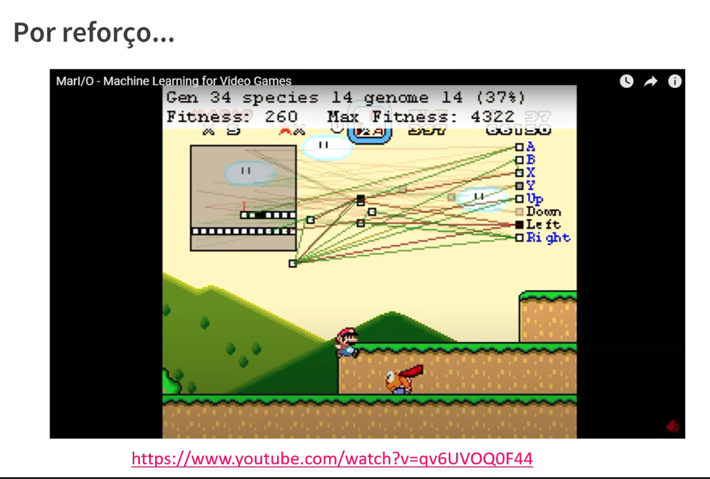

# 20_reforco_mario

[Índice da biblioteca](../../README.md)

> Fonte: `Aulas/AI-Core-Concepts/01_Material_da_Aula/prints_da_aula/20_reforco_mario.png`  
> SHA-256: `7fd516f0c863a5900ad9b95be18c03ddf16558540e916dc69440a77227264b38`  
> Imagem original incorporada para consulta visual; o texto da imagem não foi transcrito por OCR.  
> Material do acervo acadêmico fornecido pelo usuário. Autoria e direitos permanecem com os titulares indicados na fonte.

---

