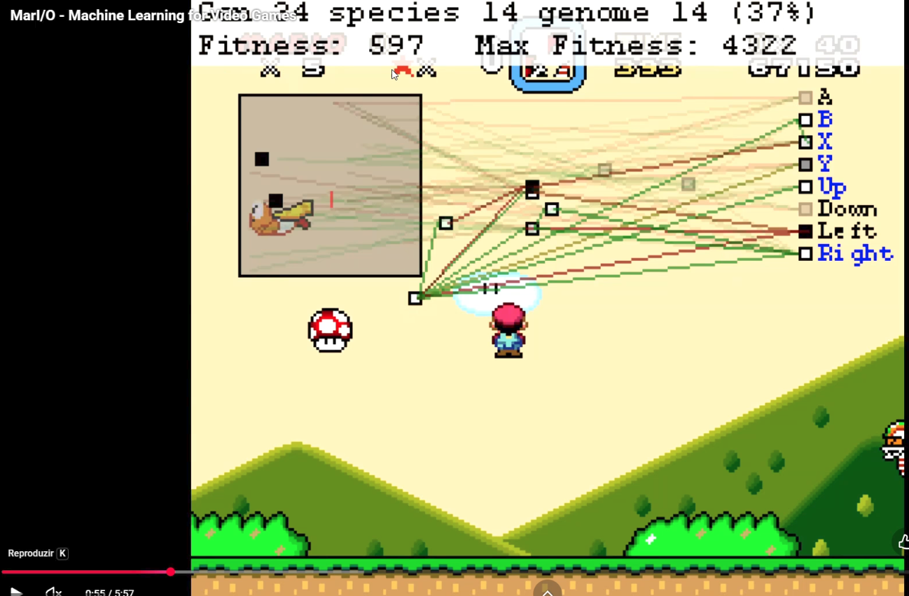

# 21_reforco_mario_video

[Índice da biblioteca](../../README.md)

> Fonte: `Aulas/AI-Core-Concepts/01_Material_da_Aula/prints_da_aula/21_reforco_mario_video.png`  
> SHA-256: `f78d1a74c9ecfb95d38214ae27101d226c0b8ed4d7e1f96f199febda5e0ce966`  
> Imagem original incorporada para consulta visual; o texto da imagem não foi transcrito por OCR.  
> Material do acervo acadêmico fornecido pelo usuário. Autoria e direitos permanecem com os titulares indicados na fonte.

---

