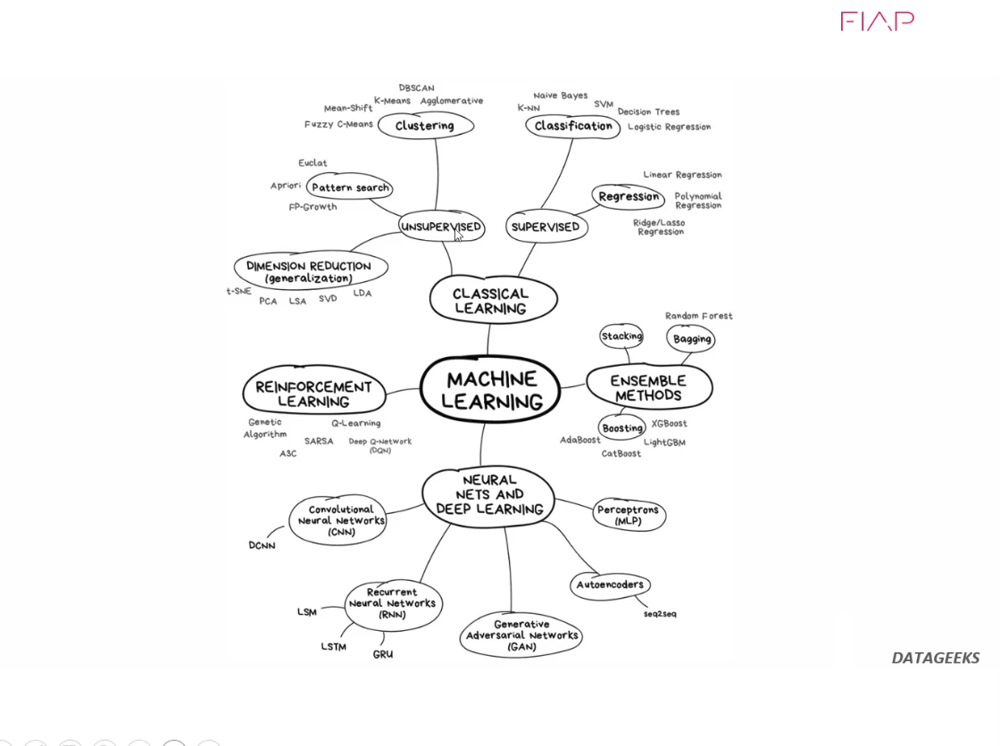

# 22_mapa_machine_learning

[Índice da biblioteca](../../README.md)

> Fonte: `Aulas/AI-Core-Concepts/01_Material_da_Aula/prints_da_aula/22_mapa_machine_learning.png`  
> SHA-256: `f66c3fb6aa7e3b37610cf53f90b4195e28265f879723c3947b89de9e2b935a50`  
> Imagem original incorporada para consulta visual; o texto da imagem não foi transcrito por OCR.  
> Material do acervo acadêmico fornecido pelo usuário. Autoria e direitos permanecem com os titulares indicados na fonte.

---

