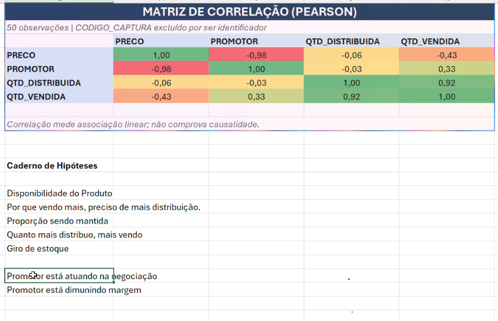

# 23_caderno_hipoteses_aula

[Índice da biblioteca](../../README.md)

> Fonte: `Aulas/AI-Core-Concepts/01_Material_da_Aula/prints_da_aula/23_caderno_hipoteses_aula.png`  
> SHA-256: `578fb2c2d7e72c4c83b5f4228d22c214a0b5b4d8fd55fd86f0b070a62ca42829`  
> Imagem original incorporada para consulta visual; o texto da imagem não foi transcrito por OCR.  
> Material do acervo acadêmico fornecido pelo usuário. Autoria e direitos permanecem com os titulares indicados na fonte.

---

