# AI_Core_Concepts_Aula1_Estudo

[Índice da biblioteca](../../README.md)

> Fonte: `Aulas/AI-Core-Concepts/03_Material_de_Estudo/AI_Core_Concepts_Aula1_Estudo.pptx`  
> SHA-256: `4479b40600232a4399987d9c0439f4d83c7482c48770674d3453890f932c677e`  
> Texto, tabelas, imagens incorporadas e notas por slide. Layout, gráficos e SmartArt podem exigir consulta ao original.  
> Material do acervo acadêmico fornecido pelo usuário. Autoria e direitos permanecem com os titulares indicados na fonte.

---

## Slide 1

AI CORE CONCEPTS · AULA 1

IA Clássica, Vieses e Correlação Estatística

Material de estudo · Resumo da aula, discussões da turma e Hands On

Profª Tassiana Rugoni de Campos  ·  FIAP MBA  ·  28/09/2026

### Notas do apresentador

Deck de estudo gerado a partir da gravação transcrita da aula, dos slides da professora e das discussões em turma. Uso pessoal: o material original da professora é protegido por direitos autorais.

## Slide 2

Roteiro da aula

1

Vieses

Seleção, confirmação e variável omitida

2

Riscos da IA

Deepfake, reconhecimento facial e enquete da turma

3

Máquinas pensam?

GANs, Teste de Turing e o caso LaMDA

4

Debate

Agentes, antropomorfização e pensamento crítico

5

IA Clássica

Tipos de ML, overfitting e o mapa do ML

6

Hands On

Correlação estatística e caderno de hipóteses

### Notas do apresentador

Objetivos da aula (PDF): conhecer a IA Clássica; entender os tipos de Machine Learning; discutir cases e vieses; aplicar IA Clássica através da correlação estatística.

## Slide 3

1

Viés de Seleção

A amostra não representa a população e a conclusão se inverte

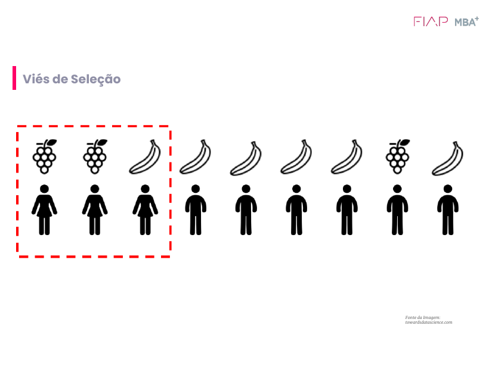

Slide da aula: 9 pessoas, e o quadrado vermelho seleciona só as 3 mulheres

67%

da AMOSTRA prefere uva
(2 de 3 mulheres)

67%

da POPULAÇÃO prefere banana
(6 de 9 pessoas)

O erro está no critério, não no tamanho: aumentar a amostra do mesmo jeito não resolve.
Em IA: modelo treinado com dados enviesados reproduz e amplia o viés (crédito, reconhecimento facial, RH).
Mitigar: amostragem aleatória ou estratificada, comparar a amostra com a população, documentar a origem dos dados.

### Notas do apresentador

Pergunta executiva: de onde vieram esses dados e quem ficou de fora? Uma amostra grande e enviesada é pior que uma pequena e representativa, porque passa confiança falsa.

## Slide 4

1

Outros vieses: Confirmação e Variável Omitida

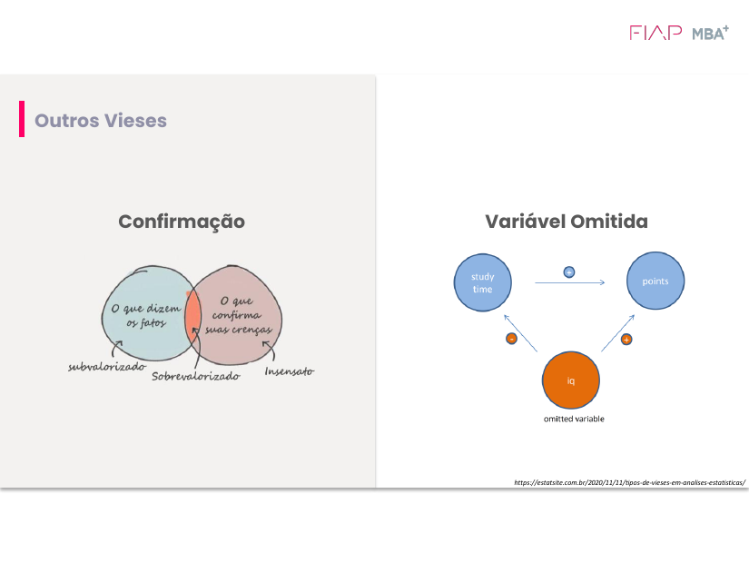

Viés de Confirmação

Fatos que confirmam a crença são sobrevalorizados; os que contradizem, subvalorizados.
Caso da professora: o gestor pede para "filtrar a base" (só 2025, tirar variáveis) até a hipótese dele parecer verdadeira.

Variável Omitida

Uma variável relevante fica fora e distorce a relação.
QI → estuda menos (−) e pontua mais (+). Sem o QI, o efeito do estudo sobre a nota parece menor ou até negativo.
→ Reaparece no Hands On (Paradoxo de Simpson).

### Notas do apresentador

Mitigação da confirmação: definir hipótese e recorte ANTES da análise, registrar todas as análises e fazer revisão independente. Mitigação da variável omitida: conhecer o domínio, mapear as causas e usar experimentos A/B.

## Slide 5

2

Tentativas de negar a mudança de modelos

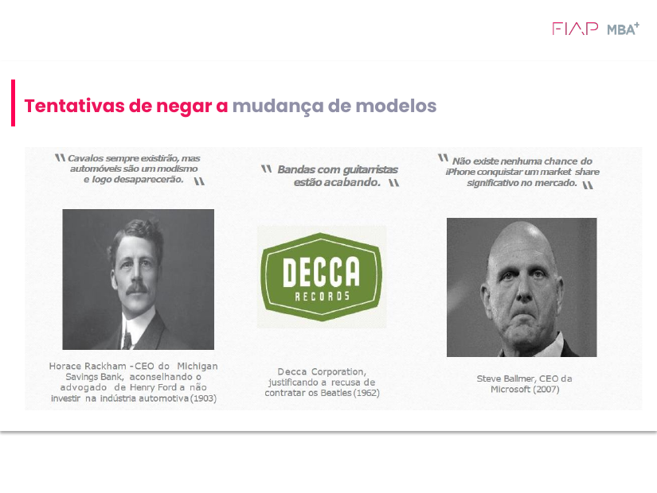

1903, Horace Rackham: "Cavalos sempre existirão; automóveis são modismo."
1962, Decca Records: "Bandas com guitarristas estão acabando" (recusou os Beatles).
2007, Steve Ballmer: "Nenhuma chance de o iPhone ter market share significativo."

Líderes avaliam o novo com os critérios do modelo antigo. A pergunta certa não é "a IA vai pegar?", e sim "o que precisa ser verdade para isso mudar meu negócio?"

### Notas do apresentador

Ligação com a Parte 1: é o viés de confirmação aplicado à estratégia.

## Slide 6

2

Os 3 desafios mais críticos da IA, segundo a turma

Enquete Poll Everywhere · 34 votos · 7 opções

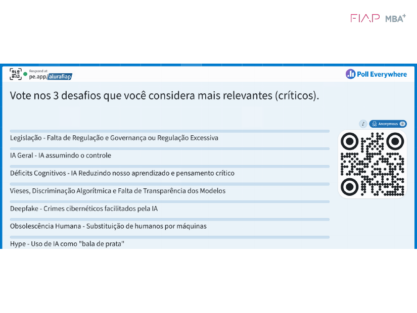

As 7 opções da enquete

1º

Déficits cognitivos

IA reduzindo o aprendizado e o pensamento crítico (também no top 3 da professora)

2º

Legislação

Falta de regulação ou regulação excessiva, que "trava a inovação"

3º

Deepfake

Crimes cibernéticos facilitados pela IA

### Notas do apresentador

Outras opções: IA assumindo o controle; vieses e discriminação algorítmica; obsolescência humana; hype (IA como bala de prata).

## Slide 7

2

Deepfake: a reunião em que ninguém era real

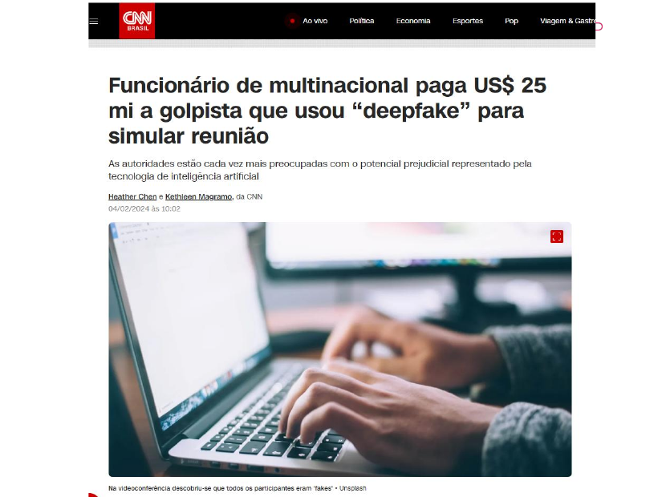

CNN Brasil, 04/02/2024

US$ 25 mi

transferidos por um funcionário após uma videoconferência em que CFO e colegas eram deepfakes (Hong Kong)

Não foi só tecnologia: como se autoriza US$ 25 mi verbalmente num Zoom? (turma da PwC)
Hierarquia pesa: quem foi clonado era um executivo sênior, e é difícil questionar "o chefe".
Lição: vídeo e voz deixaram de ser prova de identidade.
Controles: verificação fora do canal, palavra-código, dupla aprovação, limites de valor.

### Notas do apresentador

Peter: 'saber que eu não devo transferir 25 milhões numa reunião, mesmo para o CEO', é o conhecimento crítico. Com procedimento, não importa se é IA ou não.

## Slide 8

2

Reconhecimento facial e a matriz de confusão

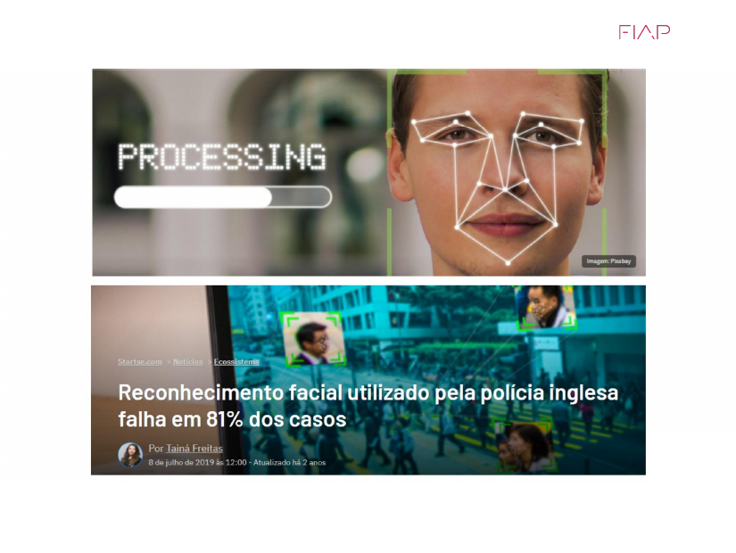

StartSe, 08/07/2019

81%

dos alertas da polícia de Londres eram falsos positivos (8 de 42 corretos)

|  | É procurado | É inocente |
| --- | --- | --- |
| Sistema: "procurado" | Verdadeiro positivo | FALSO POSITIVO |
| Sistema: "não é" | FALSO NEGATIVO | Verdadeiro negativo |

"Guerra estatística": divulgar só as taxas de FP e FN em vez dos 81% mascara o resultado.
Qual erro é pior? Depende do contexto. Aqui, FP = inocente abordado; num diagnóstico de câncer, o FN costuma ser pior.

### Notas do apresentador

Hong Kong: manifestantes usaram máscaras e óculos contra a identificação. Júlio: camiseta com estampa que torna a pessoa invisível ao algoritmo (ataque adversarial). Para ir ao ar, é preciso um painel completo de métricas.

## Slide 9

3

GANs: como se gera um rosto que não existe

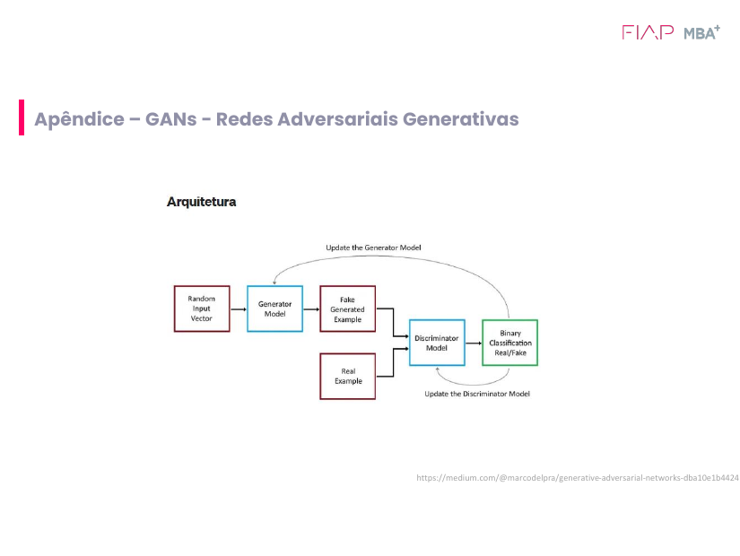

Arquitetura: gerador × discriminador

1

Gerador
cria exemplos falsos a partir de ruído (o "falsificador")

2

Discriminador
classificador binário: real ou fake? (o "perito")

3

Jogo adversarial
cada um é atualizado com o erro do outro

4

Equilíbrio
o discriminador erra ~50%, e o fake fica indistinguível

### Notas do apresentador

this-person-does-not-exist.com: no começo as imagens tinham falhas (orelha deslocada, cabelo recortado). Deep learning é usado para dados não estruturados. Goodfellow (2014). Hoje os modelos de difusão dominam a geração de imagens. A professora usa GANs para gerar bases sintéticas.

## Slide 10

3

Máquinas pensam? Do Teste de Turing ao LaMDA

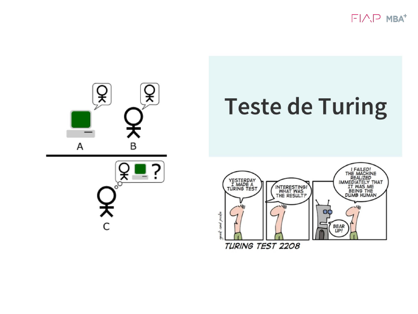

1950

Turing: se não distinguimos humano de máquina numa conversa, a máquina "passa".
"Já não serve mais pra nada" (professora).

1980

Quarto Chinês (Searle): manipular símbolos não é compreender.
Imitar ≠ entender.

2022

Google demite Blake Lemoine, que disse que o LaMDA tinha consciência.
Efeito ELIZA.

"Há 4 ou 5 anos os alunos achavam essa pergunta ridícula. Hoje já ouço alguns 'sims'." AGI e IA senciente já aparecem no Hype Cycle da Gartner.

### Notas do apresentador

Tirinha Turing Test 2208: a máquina reconhece o humano como o 'burro'. CAPTCHAs são o Teste de Turing ao contrário. Lição: antropomorfização é um viés cognitivo.

## Slide 11

4

Debate: agentes, antropomorfização e hype

"Analista Financeiro 1"

Um banco proibiu dar a um agente de IA o nome de um cargo humano. Nomear aproxima as pessoas, mas faz esquecer que é código que erra: sem humano no loop, sem guardrails.

200 agentes em 3 meses

Meta "mágica" que resultou em 200 PoCs, alguns MVPs e ROI zero. Agora: letramento, arquitetura, guardrails, humano no loop e FinOps.

Copiloto, não piloto

O humano à frente e o agente trazendo informação. Accountability: quem responde pelo erro do agente? (Peter)

"Faça UM agente funcionar"

Depois vá para o segundo. Engenheiros: "codávamos em 4 h; agora em 30 min, e levamos 8 h para entender o que a IA fez".

### Notas do apresentador

Aline: se todo cargo tiver que dominar IA, as pessoas perdem o foco na especialidade? Professora: entenda a IA para se posicionar e estabelecer limites; grandes implementações continuam com times de desenvolvimento. Peter: a IA vai ser como a datilografia, natural para todos.

## Slide 12

4

A IA reduz o aprendizado e o pensamento crítico?

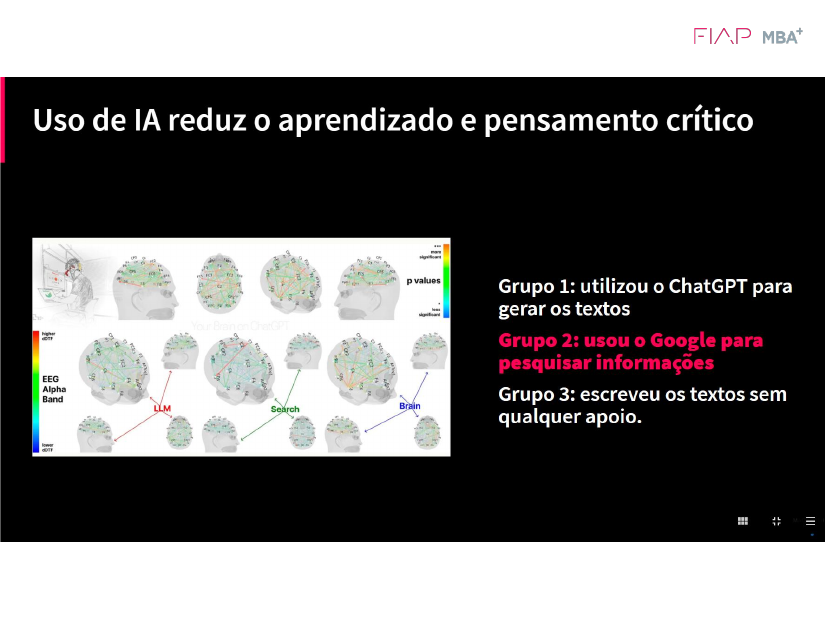

MIT Media Lab (2025), "Your Brain on ChatGPT": EEG em 3 grupos

Conectividade cerebral: sem apoio > Google > ChatGPT. "O cérebro vai desligando à medida que recebe suporte."
Memória e autoria: quem usou LLM teve dificuldade de defender a própria redação.
Nas empresas: "PPTs fantásticos e pessoas se perdendo para explicar os números".
Juniores: uma empresa cortou o acesso deles a LLMs para "não emburrecerem".
Contraponto (Peter): a escrita e a internet também mudaram o aprendizado. "Ninguém sabe mais fazer fogo, e tudo bem."

### Notas do apresentador

Ressalvas: amostra pequena, preprint. Wesley/Gartner: quem sabe fazer sem IA será o profissional valioso do futuro. Professora: a velocidade da mudança é o que mais preocupa. A máquina é ótima em hard skills, mas 'não tem alma'.

## Slide 13

05

Inteligência Artificial Clássica

"Não desprezem a IA clássica: ela ainda é pelo menos 60% da nossa atuação no mercado. E a generativa me ajudou a fazer a clássica."

## Slide 14

5

Programação tradicional × Aprendizado de Máquina

"O ML começa pelo fim"

Tradicional

Dados de entrada

Algoritmo (regras)

Dados de saída

Machine Learning

Dados de saída (rótulos)

Algoritmo de ML

Modelo

Malha fina de if-else

Fraude = ticket acima do padrão E 5 erros de senha E IP distante…
Frágil e engessada: "somos criativos para o bem e para o mal", e todo dia surge fraude nova.

Aprende com a base rotulada

Olha o histórico "fraude / não fraude" com todas as nuances. Uma fraude inédita passa uma única vez: depois é rotulada e o modelo é retreinado.
~80% da IA aplicada hoje é supervisionada.

### Notas do apresentador

Para líderes: em ML, os dados são o novo código. Vieses nos dados viram vieses no modelo.

## Slide 15

5

Aprendizado supervisionado na prática

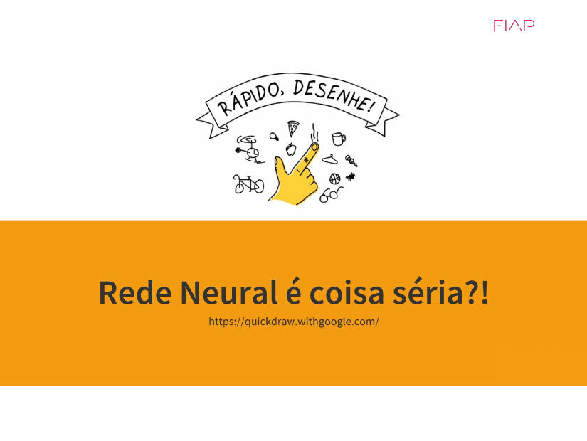

Quick, Draw! (Google)

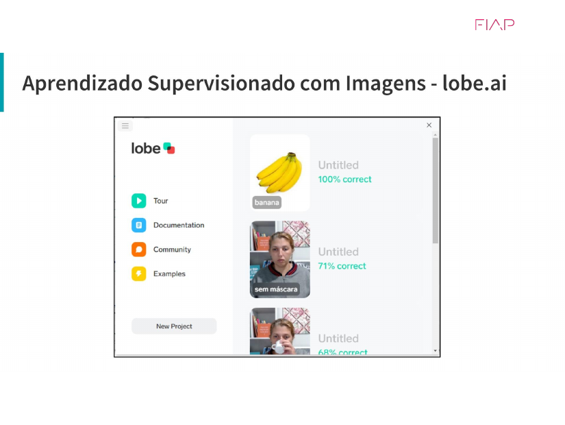

Lobe (Microsoft): com / sem máscara

Quick, Draw!: a rede compara o traço com milhões de desenhos rotulados. O rato da professora teve o maior match; o crocodilo e o sapo ficaram atrás.
Hipopótamo rosa: mostre exemplos reais e a criança reconhece até uma variação nova. Isso é aprendizado supervisionado.
Treino × teste: reserve dados inéditos para o teste; "se ele já viu, ele cola".
Rotulagem: esforço humano enorme e sujeito a erro (a OpenAI foi acusada de terceirizar essa mão de obra).

100%

de acerto não é bom

Overfitting: o modelo decorou uma amostra pequena ou idealizada. "A realidade nunca é quadrada."
Casos-limite: a mão na frente da boca, ou uma máscara com mão estampada.

### Notas do apresentador

Dataiku: plataforma colaborativa que testa de 10 a 15 modelos (AutoML) em cerca de 1 hora; depois vem o fine tuning. YOLO: detecção em tempo real, mas confundiu gato com cachorro, e um cachorro listrado pela sombra do portão virou 'tigre'.

## Slide 16

5

Os três tipos de Machine Learning

Supervisionado

Dados ROTULADOS

Classificação (fraude sim/não) e regressão (prever valor).

Professor com gabarito: o hipopótamo no zoológico.

Não supervisionado

Dados SEM rótulo

Clusterização, regras de associação, redução de dimensão.

Agrupar semelhantes sem saber o nome do grupo.

Por reforço

Agente × ambiente

Tentativa e erro com recompensa (fitness).

Castigo e prêmio: MarI/O, robôs, carros autônomos.

### Notas do apresentador

LLMs combinam os três: pré-treino autossupervisionado, ajuste fino supervisionado e RLHF (reforço com feedback humano). A professora disse que ~80% da IA é supervisionada, inclusive os LLMs.

## Slide 17

5

Classificação × Clusterização

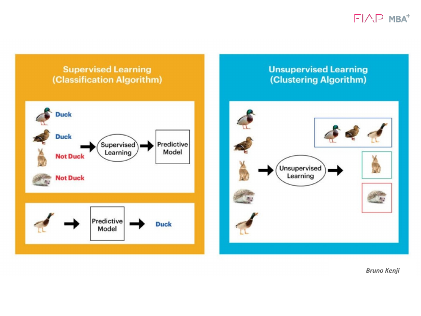

Crédito: Bruno Kenji

Caso de e-commerce: clusters de navegação

Redução de preço

Navega de forma objetiva, vai direto ao produto e não compra → oferecer desconto ("o motivo nº 1 é preço").

Oferta dos indecisos

Olha coisas muito diversas → desconto não faz sentido; a abordagem é outra (curadoria, recomendação).

### Notas do apresentador

'Classificar pato não tem utilidade, não somos zoológicos, mas fazemos muito isso no mercado.' O nome do cluster vem depois, pela interpretação humana.

## Slide 18

5

Aprendizado por reforço: o MarI/O

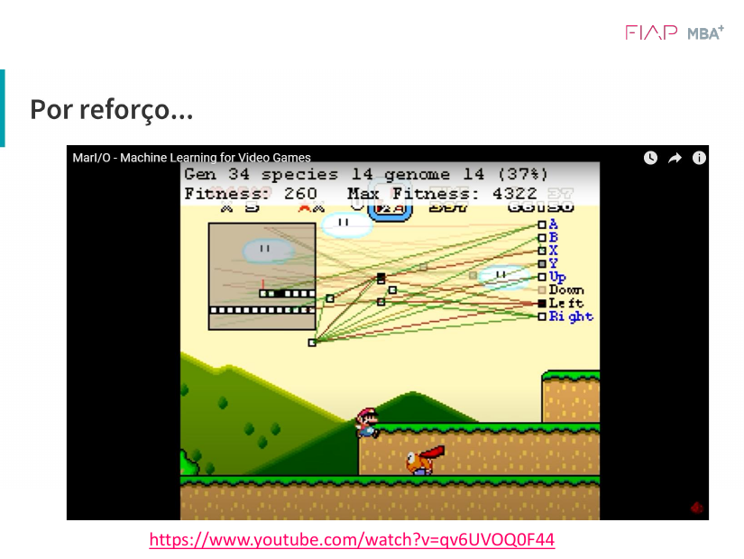

O que a IA vê: blocos e inimigos (entradas) → botões do controle (ações).
Fitness = reforço: sobe quando o Mario avança e despenca quando ele erra. "Ela entende que acerta sem entender de Mario."
Uso real: robótica e carros autônomos em simuladores: "passou no vermelho → despenca o fitness".

Regra prática da professora
Dado estruturado → Machine Learning
Dado não estruturado (imagem, vídeo, áudio) → Deep Learning

### Notas do apresentador

Nota técnica: o MarI/O usa NEAT, um algoritmo genético/evolutivo; ilustra bem o reforço (agente, ambiente, ação, recompensa). Cuidado com o 'reward hacking': o agente otimiza exatamente a métrica que você definiu.

## Slide 19

5

O mapa do Machine Learning

"Dá para passar uns três anos só aprendendo esse mapinha"

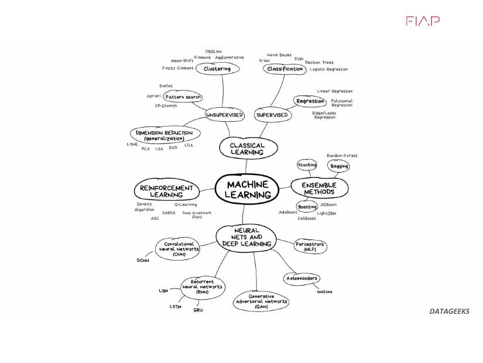

DATAGEEKS

Clássico supervisionado: classificação (árvores, SVM, regressão logística) e regressão (linear).
Clássico não supervisionado: clustering (K-Means), padrões (Apriori), redução (PCA).
Ensemble: Random Forest (bagging), XGBoost (boosting).
Reforço: Q-Learning, DQN, algoritmos genéticos.
Redes neurais / DL: CNN (imagem), RNN (sequência), GAN, autoencoders.
Próxima aula: o ramo que desce para a IA generativa (Transformers e LLMs).

## Slide 20

6

Correlação estatística (Pearson)

O quanto duas métricas caminham juntas, uma pista e não uma prova

−1

−0,4

0

+0,4

+1

Critério do exercício: r > 0,4 ou r < −0,4

🍦 Sorvete × temperatura

Forte e positiva: sobem juntas. Serve para planejar estoque e sazonalidade.

🇺🇸 Frio × varejo nos EUA

Parece forte e negativa, mas é ESPÚRIA: quem move o varejo são Ação de Graças e Natal.

🎬 Nicolas Cage × afogamentos

Perto de +1 e mera coincidência. Correlação não implica causalidade.

Ausência de correlação também é informação: "fiz uma ação de marketing e não há correlação: ela não funcionou".
Para o diretor, mostre o gráfico de dispersão, não a matriz.

## Slide 21

6

Exemplo em aula: Trade Marketing (Red Bull)

50 capturas no ponto de venda · Copilot no Excel: "Aplique correlação estatística"

|  | Preço | Promotor | Distribuída | Vendida |
| --- | --- | --- | --- | --- |
| Preço | 1,00 | −0,98 | −0,06 | −0,43 |
| Promotor | −0,98 | 1,00 | −0,03 | 0,33 |
| Distribuída | −0,06 | −0,03 | 1,00 | 0,92 |
| Vendida | −0,43 | 0,33 | 0,92 | 1,00 |

Distribuída × vendida (+0,92): disponibilidade gera venda? Ou a venda puxa a reposição? Giro de estoque?
Promotor × preço (−0,98): o promotor negocia preço? reduz margem? leva o preço sugerido? ou só vai à loja em época de promoção (variável omitida)?
Promotor × vendida (0,33): "tímido"; mas a taxa de conversão sobe (64% × 41%).

Regressão linear = Machine Learning
vendida ≈ 0,65 × distribuída − 7,6
A linha de tendência do gráfico de dispersão já é um modelo: dado um eixo, infiro o outro. Distribuindo 150 → cerca de 90 vendidas (cuidado ao extrapolar).

### Notas do apresentador

Mantemos ou demitimos o promotor? Ele impacta o preço, isso é fato; se afeta a venda é a pergunta. Falta estratégia e meta. Antes da correlação, rode a estatística descritiva (média, mediana, desvio, mín., máx.).

## Slide 22

6

Desafio CX: o Paradoxo de Simpson

Base metrica_cx_corr_v2 · 420 chamados do Suporte de TI interno

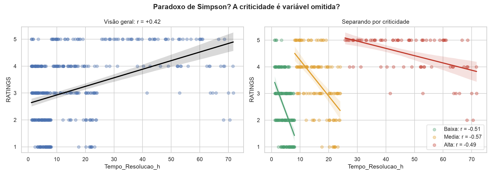

No total, tempo × satisfação = +0,42 ("demorar é bom"?!).
Dentro de cada criticidade a relação inverte: −0,49 a −0,57. A criticidade é a variável omitida: chamados críticos demoram mais E recebem notas maiores.

## Slide 23

6

Desafio CX: é o canal, não a idade

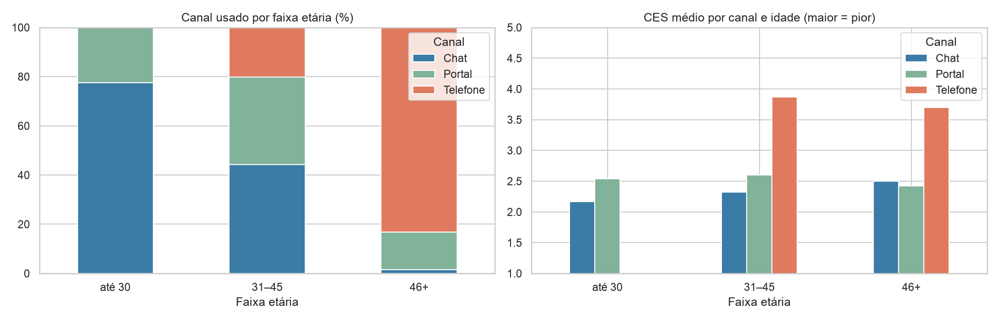

Idade × CES = +0,50 é indireta: 83% dos colaboradores com 46+ usam o telefone, e o telefone tem CES de ~3,7 a 3,9 em QUALQUER faixa etária (chat ≈ 2,2).
Ausência que informa: Criticidade × CES ≈ 0 e Tempo × CES ≈ 0. O esforço depende do canal.

### Notas do apresentador

Recomendação ao diretor: tratar o tempo de resolução como alavanca de satisfação, com metas por criticidade, começando pelo telefone. Experimento: piloto de fila expressa + callback × grupo controle.

## Slide 24

6

Caderno de hipóteses: o processo da entrega

01

Antes dos dados

Sem IA: feeling e experiência

02

Matriz

Descritiva + correlação + leitura

03

Auditoria da IA

Constatação · hipótese · causal indevida

04

Caderno final

O que entra e o que cai

05

Recomendação

Decisão, evidência, experimento, custo de errar

"Poderíamos pedir ao GPT para fazer tudo e ir dormir, mas não é a função de vocês na liderança de IA. Usem a IA como copiloto e se mantenham no loop: quem assina o caderno de hipóteses é você, não o LLM."

### Notas do apresentador

Entrega: PDF no portal com os RMs separados por vírgula; prazo até a próxima aula; informar qual IA foi usada. Hipótese que cai não é erro.

## Slide 25

Próximos passos

Anotar o grupo sorteado e os RMs dos integrantes

Preencher a Etapa 1 do caderno com o grupo, sem IA

Revisar e ajustar o caderno preenchido; exportar em PDF

Subir no portal até a próxima aula (RMs separados por vírgula)

Estudar para a próxima aula: IA Generativa e como funcionam os LLMs

"Será que a minha vida está sendo decidida por algoritmos?" · Profª Tassiana
