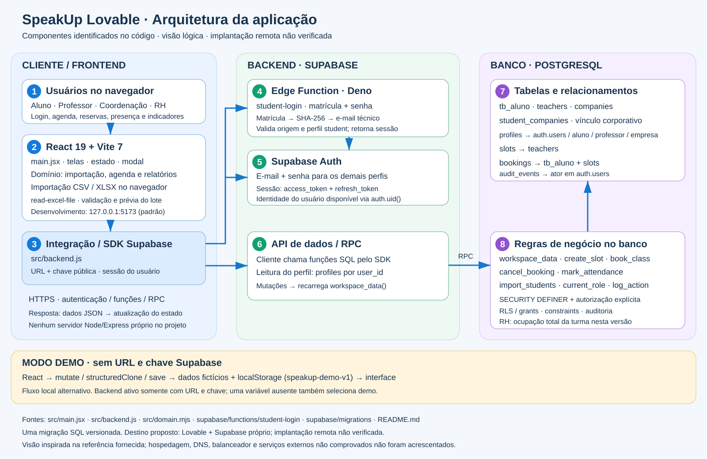
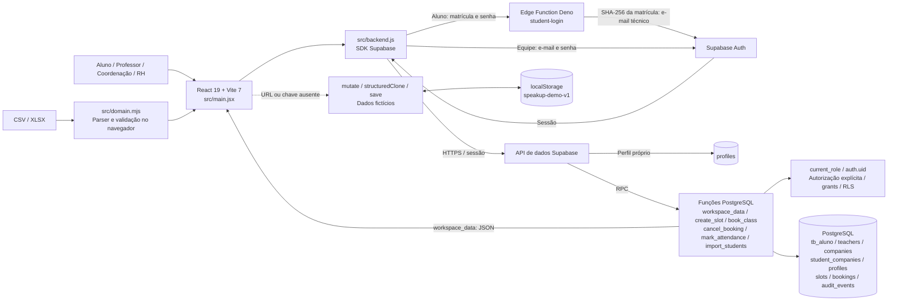

# Arquitetura do SpeakUp Lovable

Visão derivada do projeto local `speakup-lovable`. O estilo visual segue o desenho da versão SDD, com conteúdo ajustado aos arquivos desta versão. O destino proposto no README é Lovable com Supabase próprio; não foi verificada uma implantação remota.

## Frontend

- React 19, React DOM e Vite 7; `src/main.jsx` concentra a aplicação, telas, estado, modal e mutações demo.
- `src/domain.mjs`: importação, validações, agenda, reservas e indicadores. `src/demo.mjs`: dados fictícios.
- CSV e XLSX são processados no navegador; `read-excel-file` é importado diretamente em `main.jsx`.
- Desenvolvimento: `npm run dev`, host `127.0.0.1`, porta padrão do Vite 5173, podendo variar se ocupada. Build estático com `npm run build`.

## Backend

`src/backend.js` cria o cliente Supabase quando URL e chave pública estão presentes. Não há servidor próprio Express/Node no caminho das requisições da aplicação.

1. Alunos enviam matrícula e senha à Edge Function `student-login`, implementada em Deno. Ela valida origem e entrada, transforma a matrícula em e-mail técnico SHA-256, autentica no Supabase Auth e verifica `current_role`.
2. Os demais perfis autenticam diretamente no Supabase Auth com e-mail e senha.
3. O frontend consulta seu `profiles` por `user_id` e carrega `workspace_data` por RPC.
4. Alterações passam por funções SQL, seguidas de nova leitura do workspace. Não há assinatura de atualizações em tempo real neste fluxo.

O script administrativo `scripts/provision-student.mjs` provisiona contas Auth e perfis de alunos ativos com service role no terminal. É uma ferramenta administrativa, não um servidor da aplicação; não foi executado nesta tarefa.

## Banco de dados

PostgreSQL no Supabase, definido em uma migração: `supabase/migrations/202610140001_speakup.sql`.

| Tabela | Responsabilidade / vínculos |
| --- | --- |
| `tb_aluno` | Cadastro e situação de matrícula |
| `teachers` | Professores |
| `companies` | Empresas |
| `student_companies` | Aluno associado à empresa |
| `profiles` | Identidade em `auth.users`, papel e vínculo a aluno, professor ou empresa |
| `slots` | Horários, professor, grupo e capacidade |
| `bookings` | Reservas e presença; referências ao aluno e ao horário |
| `audit_events` | Ações e ator em `auth.users`; trigger impede alterações e exclusões normais |

Regras de negócio são executadas em funções SQL `SECURITY DEFINER`, com autorização explícita, `search_path` vazio, grants restritos, RLS e constraints. A política de leitura direta de `profiles` permite apenas o próprio perfil.

Atenção à diferença desta versão: `workspace_data` filtra reservas do RH pela empresa, mas o campo `occupied` soma todas as reservas ativas da turma exibida. A correção incremental da versão SDD não existe nesta pasta.

## Modo demo

O código usa Supabase somente quando `VITE_SUPABASE_URL` e `VITE_SUPABASE_PUBLISHABLE_KEY` estão presentes. Se qualquer uma faltar, usa demo, inclusive em configuração parcial. O fluxo local clona o estado em `mutate`, aplica a alteração e chama `save`, que registra auditoria demo e persiste em `localStorage` na chave `speakup-demo-v1`.

O demo não representa isolamento multiusuário no servidor. Lovable é o destino de desenvolvimento/publicação proposto no README, sem evidência local de infraestrutura de hospedagem, DNS ou balanceador. Créditos, notificações reais, faturamento e SSO/ERP não integram o fluxo implementado.

## Fontes

`package.json`, `README.md`, `vite.config.js`, `src/main.jsx`, `src/backend.js`, `src/domain.mjs`, `supabase/functions/student-login/index.ts`, `supabase/migrations/202610140001_speakup.sql` e `scripts/provision-student.mjs`.

## Verificação desta entrega

SVG validado estruturalmente como XML. `npm test`: 25 testes aprovados. `npm run build`: concluído com sucesso. Somente os arquivos de documentação foram criados; nenhuma migração ou provisionamento remoto foi executado. Os testes SQL locais não comprovam implantação ou operação remota de Auth/Edge.
