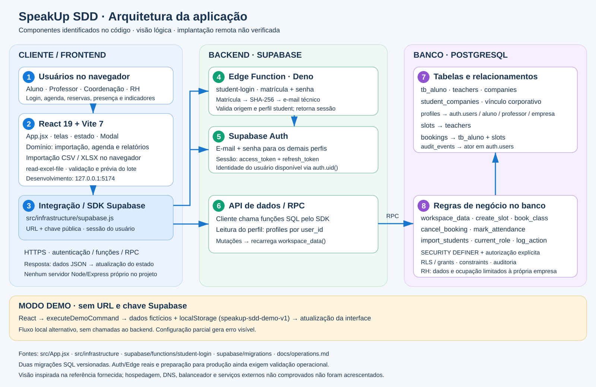
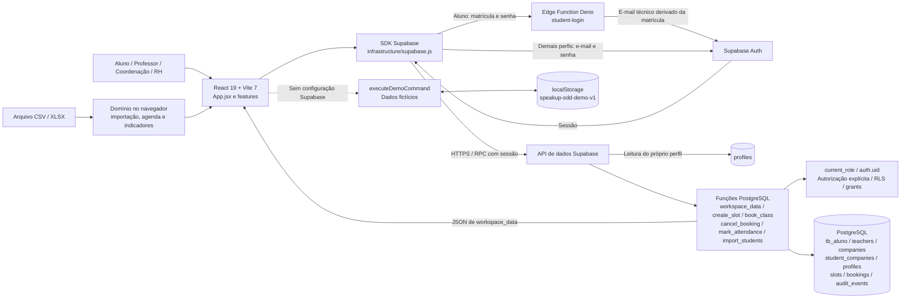

# Arquitetura do SpeakUp SDD

Visão derivada do código local. O backend remoto está implementado como integração e artefatos Supabase; esta análise não comprova implantação ou funcionamento de uma instância remota.

## Frontend

React 19 e Vite 7. `src/App.jsx` concentra estado e várias telas; `src/features/auth` e `src/features/import` contêm login e importação. `src/domain` reúne importação, agenda e indicadores. Arquivos CSV e XLSX são processados no navegador; XLSX usa `read-excel-file`. O Vite atende o desenvolvimento em `127.0.0.1:5174`; a hospedagem final não está comprovada.

## Backend

`src/backend.js` reexporta a integração em `src/infrastructure/supabase.js`. O cliente usa `@supabase/supabase-js` com `VITE_SUPABASE_URL` e `VITE_SUPABASE_PUBLISHABLE_KEY`. Não há servidor próprio Express/Node neste projeto.

- Aluno: a Edge Function `student-login` (Deno) transforma a matrícula em e-mail técnico determinístico, autentica no Supabase Auth e verifica `current_role`. Retorna tokens de sessão para o cliente.
- Demais perfis: autenticação direta por e-mail e senha no Supabase Auth.
- Perfil: consulta `profiles` por `user_id`, com política de leitura do próprio perfil.
- Dados: `workspace_data` retorna o recorte autorizado. As mutações usam RPCs SQL e depois recarregam o workspace.
- Regras: autorização explícita em funções `SECURITY DEFINER`, com `search_path` vazio, grants restritos, RLS e constraints. A proteção não depende apenas da interface ou de RLS nas tabelas.

## Banco de dados

PostgreSQL no Supabase. Definições em `supabase/migrations/202610140001_speakup.sql` e correção incremental em `202610190001_rh_occupancy.sql`.

| Tabela | Responsabilidade / vínculos |
| --- | --- |
| `tb_aluno` | Cadastro e situação de matrícula |
| `teachers` | Professores |
| `companies` | Empresas |
| `student_companies` | Associação de aluno à empresa |
| `profiles` | Identidade em `auth.users`, papel e vínculo a aluno, professor ou empresa |
| `slots` | Horários, professor, grupo e capacidade |
| `bookings` | Reservas de alunos em horários e presença |
| `audit_events` | Eventos com ator em `auth.users`; trigger impede alteração e exclusão |

A função `workspace_data` diferencia os quatro perfis. A migração incremental limita a ocupação exibida ao RH à sua empresa, inclusive em turmas mistas.

## Modo demo e limites

Sem as duas variáveis Supabase, a aplicação usa dados fictícios, `executeDemoCommand` e `localStorage` na chave `speakup-sdd-demo-v1`. Uma configuração parcial mostra erro. O demo não oferece isolamento multiusuário no servidor.

`docs/operations.md` registra pendências de produção, incluindo política de senha, rate limiting distribuído, paginação no servidor, telemetria e validação real de Auth/Edge. Não foram acrescentados DNS, balanceador, Nginx, pagamentos ou notificações reais ao desenho por falta de evidência de implementação.

## Fontes consultadas

- `package.json`, `README.md` e `specs/decisions.md`.
- `src/App.jsx`, `src/infrastructure/configuration.mjs` e `src/infrastructure/supabase.js`.
- `supabase/functions/student-login/index.ts` e as duas migrações SQL.
- `docs/operations.md`.

## Verificação desta entrega

Documentação e SVG criados sem alterações de comportamento ou execução de migrações. A validação estrutural do SVG é registrada na entrega. As verificações do AGENTS.md (testes, build, E2E e formatação) devem ser reportadas com o resultado efetivo.

Resultado efetivo: SVG analisado como XML com sucesso. `npm test`: 26 testes aprovados e uma falha ao carregar `@electric-sql/pglite` no teste de banco. `npm run build`, `npm run test:e2e` e `npm run format:check` foram tentados e não iniciaram suas ferramentas, pois `vite`, `playwright` e `prettier` não estão disponíveis no ambiente. Não foram instaladas dependências para esta alteração documental.
