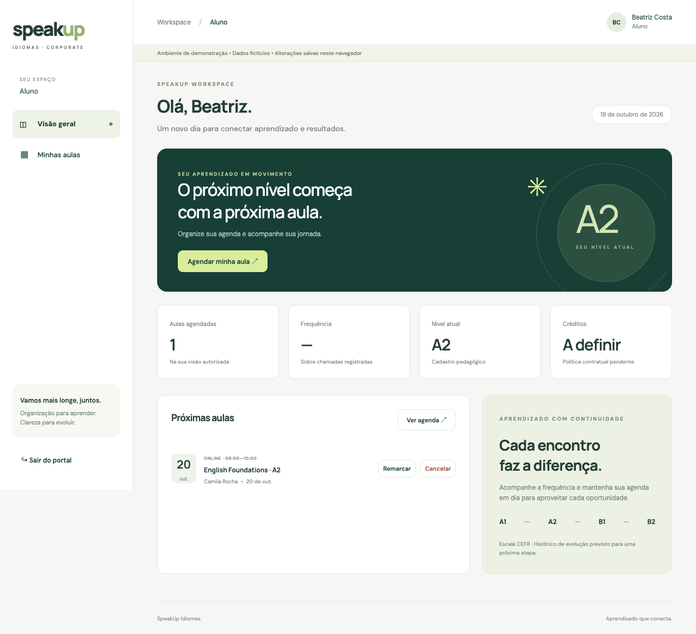
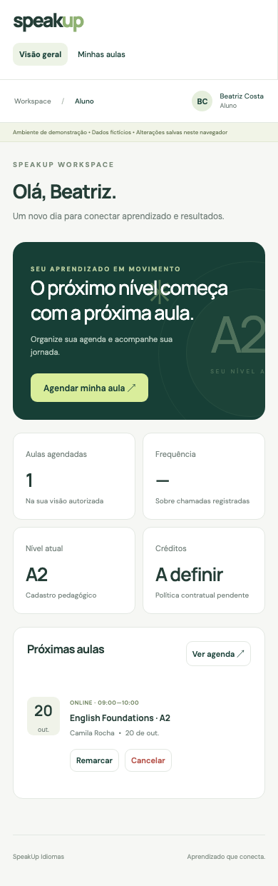

# Resultado da comparação

A implementação original é uma base funcional de piloto com controles relevantes de engenharia: validações, transações, constraints de agenda, autorização no banco e testes. A evolução SDD preserva esses pontos, organiza o trabalho em especificações rastreáveis e corrige problemas reproduzidos nos mesmos cenários.

**Entregue:** uma cópia executável do software em `speakup-sdd`, especificações, critérios de aceite, decisões arquiteturais, migração incremental, testes e este relatório lado a lado. O original `speakup-lovable` foi preservado; os hashes dos 25 arquivos inventariados continuam iguais, excluindo dependências, build e Git.

**Validação final:** original 25/25 testes herdados; SDD 40/40 testes Node (incluem testes agrupadores) e 4/4 testes de navegador. Ambos os builds passam. Os 40 testes não são uma medida de cobertura nem diretamente equivalentes aos 25 herdados; a comparação controlada é feita pelos cenários adicionais aplicados a ambos.

A nova versão é uma evolução do mesmo piloto, não uma implementação completa de todo o PRD. Não foi promovida a produção e nenhum Supabase remoto foi alterado.

# Método e fontes

Foram lidos os três documentos originais e o código local. As extrações textuais estão em `specs/sources/`; elas não substituem a leitura visual dos Word, especialmente em formulários com escolhas. O material fornecido contém um interpretador cuja saída prevista é um prompt de configuração de kernel, e não a aplicação completa. Não foi presumido que seu texto comprove escolhas preenchidas em outro configurador.

A skill exata “Spec-Driven Development with Coding Agents” não foi localizada. Após autorização para prosseguir, foi aplicado o fluxo explícito **fontes → requisitos → critérios de aceite → decisões → tarefas → implementação → validação**. Não se atribui esta entrega à execução daquela skill indisponível.

A baseline foi copiada para diretório temporário, com os arquivos originais preservados. Para executar as duas versões sob dependências equivalentes, a baseline usou a mesma árvore instalada da versão SDD. A resolução npm não reproduz exatamente o pnpm-lock original: por exemplo, PGlite 0.5.10 em vez de 0.5.9 e React 19.3.1 em vez de 19.3.0. As versões constam em `dependencies.json`. Essa normalização permite comparar o código no ambiente desta execução, mas não prova o resultado do lock antigo em outros ambientes.

O exercício não mede produtividade, custo de desenvolvimento ou superioridade universal de um método. Os cenários novos foram escolhidos durante a revisão e são direcionados a riscos identificados. Não foram atribuídas notas subjetivas de maturidade nem percentuais fictícios de conformidade.

# O mesmo software lado a lado

<div class="screens"><figure><figcaption>Original • mesmo aluno fictício e fluxo</figcaption></figure><figure><figcaption>SDD • interface preservada, organização e regras evoluídas</figcaption></figure></div>

Capturas produzidas pelos testes em Chromium, viewport 1280×900, em 19/10/2026. Imagem de página inteira. A aparência semelhante é intencional: as alterações estão sobretudo na estrutura, consistência e validação.

| Dimensão | Original Vibe Coding | Evolução SDD | Evidência |
|---|---|---|---|
| Produto e requisitos | PRD/PSS detalhados e diagnóstico de lacunas já presentes. | Especificação explícita do piloto, aceite, ADRs, tarefas e vínculos com testes. | specs/requirements.md; specs/acceptance.md |
| Arquitetura e manutenção | App, fluxos, importação e interface concentrados em main.jsx; domínio e backend já separados. | Entrada mínima; App.jsx; domínio por capacidade; infraestrutura; caso de uso demo; telas de login/importação; modal reutilizável. App ainda concentra agenda, presença e relatórios. | src/main.jsx; src/App.jsx; src/domain/; src/features/ |
| Dados e importação | 19 colunas, matrícula textual, datas/decimais e rollback transacional no SQL. Prévia cliente não aplica todos os limites do servidor. | Preserva integridade do SQL; bloqueia 5.001 linhas e idade fora do inteiro; apaga prévia antes de analisar novo arquivo. | tests/regression.test.mjs; tests/browser/import.spec.js |
| Agenda | Constraints de sobreposição e locks no SQL já presentes. Demo compara strings e aceita casos inválidos. | Compara instantes com fuso, valida datas e capacidade; rejeita remarcação para mesma aula. | src/domain/scheduling.mjs; AC-02/03/10 |
| Autenticação e configuração | Supabase Auth e perfil provisionado; URL/chave parcial resulta em null e abre demo. | Configuração parcial gera erro; inicialização explícita; cliente Supabase sob demanda. Senha compartilhada permanece pendente. | src/infrastructure/configuration.mjs; AC-01 |
| Autorização e privacidade | RLS, grants e RPCs por perfil; RH tem vínculo empresa separado de unidade. Contagem occupied inclui outras empresas na aula. | Preserva controles; migração incremental restringe occupied à empresa do RH. Booking IDs e metadados continuam presentes; não é anonimização formal. | supabase/migrations/202610190001_rh_occupancy.sql; AC-07 |
| UX e acessibilidade | Interface responsiva; reserva demo e largura mobile passam. Modal não move foco ao abrir. | Mesma identidade visual; dialog nativo com foco, Tab, Escape e restauração testados. Sem certificação de acessibilidade integral. | src/ui/Modal.jsx; tests/browser/booking.spec.js |
| Testes e qualidade | 25 testes herdados passam; sem testes de navegador no pacote original. | 40 testes Node, 4 cenários de navegador, regressões aplicáveis à baseline, logs e comparação reproduzível. Não há percentual de cobertura medido. | reports/validation.json; scripts/compare.py |
| Desempenho e escala | Uma resposta workspace_data carrega a coleção autorizada; paginação no cliente. | Mesma limitação de escala. XLSX e SDK Supabase em chunks sob demanda; entry demo menor. Sem teste de carga ou comprovação de 2 segundos. | reports/build-original.log; reports/build-sdd.log |
| DevSecOps e dependências | pnpm-lock.yaml; scripts test/build. | package-lock.json, checagem de formato e workflow CI proposto. npm audit consultado sem vulnerabilidades conhecidas retornadas. | reports/dependencies.json; reports/dependency-audit.json; .github/workflows/validate.yml |
| Operação e observabilidade | Logs de ações no banco e ressalvas no README. | Runbook, plano de rollback e pendências explícitas. Não há métricas, alertas, traces ou rotina de recuperação implantados. | docs/operations.md |
| Escopo e governança | Créditos, notificações, faturamento e integrações reconhecidos como futuros. | Mesmas pendências preservadas; decisões não resolvidas são identificadas, sem inventar regras contratuais. | specs/decisions.md; README.md |

# Resultados executados sob os mesmos cenários

| Verificação | Original | SDD | Interpretação |
|---|---|---|---|
| Suíte própria original / suíte própria evoluída | 25 passam | 40 passam | Contagens incluem agrupadores Node; suítes de tamanho diferente |
| Nove cenários dirigidos de domínio | 1 passa; 8 falham | 9 passam | Mesmas entradas aplicadas a ambos; sem rede |
| RH em aula de duas empresas | occupied = 2 para RH A | occupied = 1 para RH A | Novo teste SQL; correção de contagem fora do escopo corporativo |
| Reserva pelo aluno demo | Passa | Passa | Preservação do fluxo funcional |
| Dashboard a 390×844 | Passa | Passa | Não há overflow horizontal no cenário testado |
| Foco inicial do modal | Falha | Passa | No original o foco permanece fora; verificação interrompe nesse primeiro erro |
| Novo upload inválido após prévia válida | Prévia antiga permanece | Prévia antiga removida | Impede confirmar acidentalmente o lote anterior |
| Build local | Passa | Passa | Não comprova deployment ou backend real |
| Formatação | Sem gate equivalente no pacote | Passa | Prettier; não equivale a lint semântico ou análise de tipos |

Os oito testes de domínio que falham no original cobrem: intervalo invertido em UTC, data inválida, capacidade fora de faixa, intervalos adjacentes com offsets distintos, remarcação para mesma aula, lote de 5.001 alunos, idade fora de inteiro PostgreSQL e reserva com data inválida. Eles agrupam falhas relacionadas; não são oito vulnerabilidades independentes.

As falhas de agenda e parte dos limites de importação dizem respeito ao domínio cliente/demo: o PostgreSQL original já impõe diversas dessas regras. A interface normal converte horários para ISO UTC, o que reduz a exposição cotidiana ao caso de offsets distintos. Os testes verificam consistência do domínio sob entradas adversas; não alegam que todos esses casos são alcançáveis pela tela atual.

# Achados corrigidos e sua importância

## F-01 — Contagem corporativa além do escopo autorizado

**Prioridade: alta para isolamento de informações B2B.** `../speakup-lovable/supabase/migrations/202610140001_speakup.sql:77` limita quais aulas o RH pode ver, mas a subconsulta de ocupação conta todas as reservas da aula. Em uma aula compartilhada, RH A consegue inferir ocupação além de sua própria empresa.

A migração `202610190001_rh_occupancy.sql:14` acrescenta o vínculo corporativo à contagem quando o perfil é RH. O teste AC-07 cria empresas A/B e dois alunos na mesma aula: o original retorna 2, a versão corrigida retorna 1 para RH A. A capacidade física da aula continua visível; confirmar com o responsável se esse metadado faz parte do contrato. Não foi demonstrado vazamento de nome ou e-mail de outra empresa nesse cenário.

## F-02 — Prévia obsoleta depois de erro de importação

**Prioridade: média para integridade operacional.** Em `../speakup-lovable/src/main.jsx:17`, o novo upload só substitui a prévia se a validação tiver sucesso. Se um lote válido for seguido por arquivo inválido, o erro aparece, mas a prévia antiga e sua confirmação permanecem.

A versão SDD limpa a prévia antes de analisar o novo arquivo (`src/App.jsx`, função upload). AC-05 reproduz a sequência em navegador real. O backend original ainda valida o lote recebido; o problema aqui é o usuário confirmar uma prévia que já não corresponde à última seleção.

## F-03 — Modal sem gestão de foco

**Prioridade: média para acessibilidade.** O modal original declara role/aria-modal, mas não move foco, contém navegação ou implementa Escape. O teste comparável falha já na entrada de foco, sem atribuir automaticamente resultado às etapas seguintes.

`src/ui/Modal.jsx` usa dialog nativo, showModal, tratamento de cancelamento e restauração do foco anterior. A versão SDD passa na sequência foco inicial → Tab → Escape → retorno ao acionador. Isso não certifica todas as necessidades de teclado, leitores de tela, contraste ou WCAG.

## F-04 — Configuração parcial abre demonstração

**Prioridade: média para confiabilidade de ambiente.** `../speakup-lovable/src/backend.js:3` instancia o backend apenas quando URL e chave estão presentes; uma variável isolada deixa supabase nulo e a aplicação usa demo. Isso pode confundir um operador durante configuração. O banner de demonstração original reduz essa ambiguidade, mas não a elimina.

`src/infrastructure/configuration.mjs` distingue ausência total, par válido e configuração parcial. A última gera erro visível, sem carregar o estado fictício. Também rejeita URL inválida e HTTP remoto. AC-01 cobre a seleção de modo; Supabase Auth e Edge Function não foram exercitados em conta real.

## F-05 — Regras cliente e servidor divergentes

**Prioridade: média para consistência, menor onde a UI já restringe a entrada.** Comparação textual em `../speakup-lovable/src/domain.mjs:30` não equivale a comparar instantes com diferentes fusos. A função assertSlot não aplica o intervalo de capacidade do SQL. O demo permite remarcar para a mesma aula, enquanto o SQL rejeita.

`src/domain/scheduling.mjs` compara epoch, valida instantes com fuso e capacidade e rejeita a mesma aula. `src/domain/import.mjs` antecipa os limites de lote e inteiro já relevantes no servidor. Mantiveram-se os testes de reservas, lotação, remarcação atômica, importação transacional e acesso negado.

# Rastreabilidade dos requisitos do produto

| Requisito | Situação original | Situação SDD | Limite ou evidência |
|---|---|---|---|
| RF-01 Grade | Implementação piloto | Preservada e domínio reforçado | Constraints SQL + testes de conflito; sem concorrência real certificada |
| RF-02 Autoatendimento | Piloto funcional | Preservado e regressões corrigidas | Reserva demo validada; três cliques de todos os fluxos não auditados |
| RF-13 Importação | Piloto funcional | Prévia e limites corrigidos | CSV no navegador e SQL testados; XLSX legado preservado, sem novo E2E específico |
| RF-05 Presença | Parcial quanto a tempo real | Mesmo limite | Atualiza após própria mutação; sem refresh automático entre usuários |
| RF-06 RH | Parcial | Isolamento de ocupação corrigido; continua parcial | Aprovação de medição depende de RF-08 |
| RF-03 Créditos | Pendente | Pendente | Política de cancelamento e expiração não definida |
| RF-04 Notificações | Pendente | Pendente | Sem envio real ou calendário |
| RF-08 Medição e fatura | Pendente | Pendente | Sem regras contratuais suficientes |
| RF-09 Substituição | Pendente | Pendente | Sem recomendação implementada |
| RF-07 Histórico CEFR | Pendente | Pendente | Nível cadastrado não representa histórico |
| RF-10 SSO/ERP | Pendente | Pendente | Sem provedores integrados |
| RF-12 Auditoria | Parcial | Preservada; operação documentada | Trigger bloqueia alterações comuns; proprietário não perde poderes |

A dependência RF-06 P0 → RF-08 P1 precisa de revisão do produto: a aprovação financeira é P0 no portal, mas seu módulo habilitador está em prioridade inferior. A versão SDD registra a inconsistência em vez de criar aprovação fictícia.

# Arquitetura da evolução

```text
PRD/PSS/interpretador → specs/requirements + acceptance + decisions + tasks
                                  ↓
src/main.jsx → inicialização do backend → src/App.jsx
                                          ├─ features/auth/LoginView
                                          ├─ features/import/ImportView
                                          ├─ ui/Modal
                                          ├─ application/executeDemoCommand → estado demo → localStorage
                                          └─ infrastructure/Supabase → RPCs → PostgreSQL
                                                                              ├─ grants/RLS
                                                                              ├─ validação/autorização
                                                                              └─ constraints/auditoria
```

A separação melhora os pontos de mudança, mas a refatoração é incremental: App.jsx ainda concentra estado e telas de agenda, chamada e relatórios. A nova estrutura não é apresentada como arquitetura hexagonal completa nem exige microserviços sem necessidade. SQL continua como autoridade de autorização e integridade no modo conectado; o demo é apenas demonstração local.

# Segurança, dados e operação ainda pendentes

- **Senha universal:** PRD/PSS alternam senha fixa e inicial. Mantida por fidelidade ao material; resolver com o dono do produto antes de uso real. Não foi criada mudança silenciosa da política.
- **Controle de tentativas:** a Edge Function não implementa limitação distribuída no código inspecionado. O README exige configuração no destino; não se presumiu que a proteção está ativa. CORS não substitui autenticação.
- **Sessão e integração:** a recuperação inicial de perfil existe; não há evidência de teste de expiração/revogação entre abas nem de integração Auth/Edge real.
- **Minimização:** RH não recebe cadastro completo, mas IDs de reservas e metadados continuam; chamar isso de anonimização irreversível seria incorreto. Há somente minimização parcial.
- **Escala:** workspace_data retorna coleções completas. Busca/paginação administrativa no cliente não demonstra RNF-06. Projetar paginação, filtros por período e consultas medidas antes de prometer 5.000 usuários.
- **Concorrência:** locks e constraints já existem. Testes PGlite em uma conexão não reproduzem corridas, deadlocks ou carga de múltiplas sessões; executar teste PostgreSQL/Supabase com conexões independentes.
- **Auditoria e recuperação:** não há prova de retenção imutável externa por 12 meses, backup restaurado ou RPO/RTO atendido. O trigger não protege contra o administrador do banco.
- **Observabilidade:** logs de negócio não substituem métricas, traces e alertas. O runbook propõe o que medir; nada disso foi declarado implantado.
- **Privacidade e conformidade:** nenhum exame jurídico/operacional de LGPD foi executado; TLS/AES não foram medidos. Nenhuma das versões recebe declaração de conformidade integral.
- **Acessibilidade e UX:** falta validação com leitores de tela, mais perfis e fluxos, contraste e tarefas completas de três cliques. O teste mobile cobre apenas o dashboard de aluno.
- **Importação:** não houve ensaio de planilhas comprimidas hostis nem novo teste ponta a ponta de XLSX. Os limites de arquivo e validações não equivalem a auditoria de todos os parsers.
- **Qualidade de código:** há formatação automática, testes e CI definido; não foram introduzidos TypeScript, lint semântico ou meta de cobertura. O workflow não foi executado no GitHub; não existe repositório Git nesta pasta de trabalho.

# Desempenho observado e dependências

No build comparável **sem variáveis Supabase**, o entry JavaScript passou de **285,44 kB (88,26 kB gzip)** para **255,01 kB (80,19 kB gzip)**. O parser XLSX fica em chunk de 36,47 kB e o SDK Supabase em chunk de 228,59 kB, carregados quando necessários. O total de artefatos SDD é maior por incluir explicitamente a alternativa de backend e a separação de módulos. A redução do entry não demonstra menor tempo de resposta do servidor nem latência de produção. Em modo conectado, o SDK é carregado antes da aplicação renderizar.

A consulta npm audit retornou **zero vulnerabilidades conhecidas** na árvore instalada, conforme `dependency-audit.json`. Isso é o resultado do registro consultado para essas versões, não uma prova de ausência de falhas no código ou nas dependências. Não foram medidas despesas de nuvem ou custo por usuário, pois não há ambiente implantado nem carga representativa.

<div class="screens mobile"><figure><figcaption>Original • 390×844</figcaption></figure><figure><figcaption>SDD • 390×844</figcaption></figure></div>

# Como reproduzir e evoluir

```sh
cd speakup-sdd
npm ci
npx playwright install chromium
npm test
npm run build
npm run format:check
npm run test:e2e
python3 scripts/compare.py
```

A comparação pressupõe `../speakup-lovable`, hashes originais iguais e capacidade de abrir servidor local/Chromium. Cria uma baseline temporária, registra exit codes reais em validation.json e mantém as falhas esperadas do original nos logs. O diretório temporário da execução consta no JSON. CI proposto executa testes/formatação/build/navegador se esta pasta for a raiz do repositório; adaptar working-directory se o repositório englobar a disciplina inteira.

Para comparar manualmente, execute o original com `npm run dev -- --port 5173` e a SDD com `npm run dev` na porta 5174. O original precisa de suas dependências corretamente instaladas; o pacote copiado tinha links node_modules incompletos, razão pela qual os testes usaram baseline isolada. Os dados demo são fictícios e usam namespaces diferentes de localStorage.

Próximos passos, por dependência: resolver regras de senha/créditos/medição com o produto; validar Auth/Edge e segregação em desenvolvimento; implementar paginação e atualização entre usuários; realizar concorrência/carga/restore; revisar privacidade e acessibilidade; só então avaliar promoção operacional. Não são estimados prazos sem dimensionamento.

# Artefatos e trilha de evidências

- [Especificação](<../specs/requirements.md>), [aceite](<../specs/acceptance.md>), [decisões](<../specs/decisions.md>), [tarefas](<../specs/tasks.md>) e [matriz rastreável](<../specs/traceability.json>).
- [Resultados e comandos](<validation.json>), [testes originais](<tests-original.log>), [testes SDD](<tests-sdd.log>), [regressões no original](<regression-original.log>) e [regressão SQL](<database-original-regression.log>).
- [Navegador original](<browser-original.log>), [navegador SDD](<browser-sdd.log>), [build original](<build-original.log>), [build SDD](<build-sdd.log>), [dependências](<dependencies.json>) e [npm audit](<dependency-audit.json>).
- [Hashes do original](<original-sha256.json>), [instruções para agentes](<../AGENTS.md>) e [operação](<../docs/operations.md>).

# Referências técnicas primárias

O uso de funções SECURITY DEFINER exige revisão de privilégios e search_path; os controles foram inspecionados e testados no contexto local descrito. Referências: [RLS no Supabase](https://supabase.com/docs/guides/database/postgres/row-level-security) e [funções de banco no Supabase](https://supabase.com/docs/guides/database/functions).

A existência de locks não comprova ausência de deadlocks ou corridas sob carga: [documentação PostgreSQL sobre locking](https://www.postgresql.org/docs/17/explicit-locking.html).

Os critérios de foco, teclado e Escape do modal foram orientados pelo [padrão de diálogo modal da W3C](https://www.w3.org/WAI/ARIA/apg/patterns/dialog-modal/). A aprovação dos testes locais não equivale a certificação de acessibilidade.
